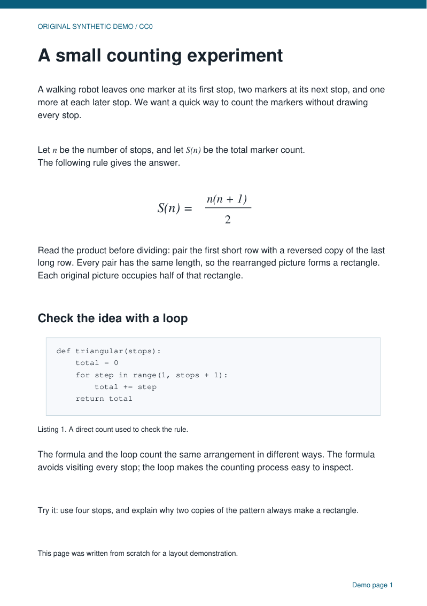
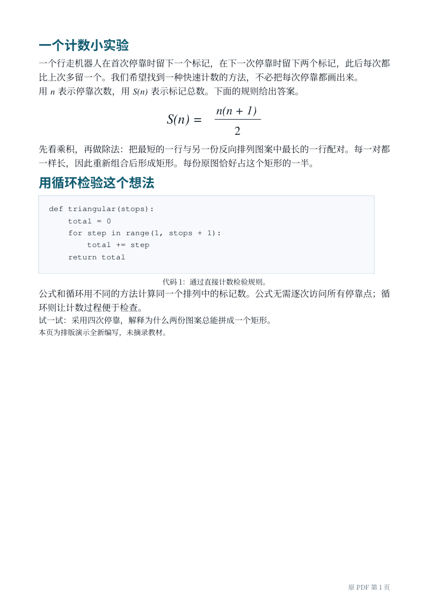
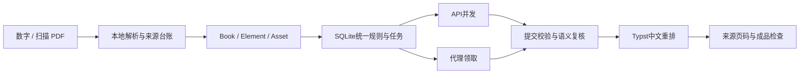

# Textbook PDF Translator · 大型教材 PDF 中文重排翻译

保留原公式，按中文阅读习惯重新排版；允许增页，并在页边标明原书页码。

面向公式、习题、代码和图表较多的英文教材。支持数字PDF、无文字层扫描PDF、旧隐藏OCR及混合文档；无需先有电子书签或目录索引。**当前为2.0.0-rc.7候选版，Rosen全书翻译与最终验收仍未完成。**

[创新与竞品对比](docs/INNOVATION.md) · [安装](docs/INSTALL.md) · [工作流程](docs/WORKFLOW.md) · [扫描支持](docs/SCANNED_PDF.md) · [验证记录](docs/VALIDATION.md) · [English](README.en.md)

**自行运行：** 双击 **开始翻译.bat**，选择PDF或已有任务目录，再点“开始 / 继续翻译”。新桌面入口自动分批、并发保存和续传，可安全停止、无API重新出稿；疑难页单独标记，其余内容继续。输出中文阅读稿和原书页码检查清单，最终验收可在出稿后单独进行。[自动模式使用说明](docs/AUTOMATIC.md)

**并发可手调：** 默认32，可输入1–32；每批任务数跟随设置，解除固定8份的限制。可选多个供应商组成的翻译池，各路线按容量和限额分担，限流冷却后继续。断点和部分有效结果保留，复核模型独立手选。[并发与路由](docs/MODEL_ROUTING.md)

rc.7修复同题超过6项永久跳过、图内标签溢出引起整页退回原文、跨页单元被失败重试拆开，以及大型PDF合并缓慢。图形和公式保持原尺寸，完整原题作为分包只读上下文，原有有效译文继续复用。[本次修复与边界](docs/READING_REPAIR.md) · [全书进度](docs/ROSEN_PROGRESS.md)

**验收仍有阻断：** 普通数学字体旧裁片、复杂数学结构及图文关系仍在处理。source-v72保留1,748条来源待修/待核诊断，不是已确认的数学错误数；旧成品对裁片的像素通过不能证明裁片对原书完整。[原始风险范围](evidence/ordinary-math-ink-risk-20261022.json)

## 核心能力

英文译为中文后，继续往原文字框里塞内容容易缩字、溢出或打散图文。本工具复用BabelDOC解析及开源识别模型，以中立书籍结构连接翻译和Typst排版，让段落正常断行、续页，并保持各类内容字号统一。

- **阅读重排**：正文10.5pt、习题9.5pt、图注脚注8.5pt；公式有实际宽高与基线，图注、解释和习题按关联参与分页。
- **多行公式排版**：已确认的完整公式可显式独立成块，短注解跟随公式，题号对齐首行正文；保持原尺寸，超宽时明确报告。[检查范围](evidence/display-math-layout-20261023.json)
- **完整论证**：将前提、原分隔线、结论与原生标记作为有序单元排版，联合复核整条论证，并拒绝过期会话沿用旧资产或术语判定。[接口与范围](docs/ARGUMENTS.md)
- **设计随正文移动**：来源明确的定义底色与页边标签作为组合分页，最终核对原CMYK及全部字体资源；习题短行保持自然字距。[范围与检查](docs/DESIGN_PANELS.md)
- **公式原样保护**：数字页保留原矢量对象，扫描页保留原图对象；译文用严格身份标记，提交时检查缺失、重复和改写。
- **API与代理并行**：共享SQLite任务、租约、规则版本和结果校验，支持暂停续传、部分有效提交和单段重做。
- **显式复核规则（实验）**：为已核实的数量单位、日期、月份及世纪建立单元素规则；已证明连续的跨原页正文可整体复核，检查中文短语移动后无遗漏、无重复。[范围与用法](docs/EXPLICIT_REVIEW.md)
- **来源可查**：页边标记实际原书页码；未知时用原PDF物理页。增页仍能找到来源。
- **扫描图像优先**：本地识别完整合成页，先保护公式再识别正文；旧隐藏OCR不当作可靠真值。
- **可追踪检查**：来源覆盖、占位符、数字、术语、语义抽样、成品对象像素及视觉验收分别记录。已知解析阻断问题会停止默认付费全流程。

这些是围绕教材的**工程设计与组合改进**。OCR、公式检测、PDF解析和排版引擎来自成熟开源项目；尚无证据宣称算法首创或整体超过其他工具。[对比与源码依据](docs/INNOVATION.md)

## 先跑起来

已验证Windows x64、Python3.13（64位）。首次安装需联网，仓库不带模型权重或运行所需中文字库；测试仅附四个自绘小字体。

```powershell
git clone https://github.com/st-cx/textbook-pdf-translator.git
cd textbook-pdf-translator
powershell -ExecutionPolicy Bypass -File .\安装依赖.ps1
```

将 `config.example.json` 复制为 `config.json`，填写自己的供应商、模型和密钥。**先分析少量页**：

```powershell
.\.venv\Scripts\python.exe translate_pdf.py "书.pdf" --stage prepare --pages 1-3 --out "试译" --no-legacy-import
```

核对识别和公式边界后，运行翻译、复核和排版：

```powershell
.\.venv\Scripts\python.exe translate_pdf.py --out "试译" --stage translate --provider example --workers 2
.\.venv\Scripts\python.exe translate_pdf.py --out "试译" --stage review --review-provider example --workers 2
.\.venv\Scripts\python.exe translate_pdf.py --out "试译" --stage layout
.\.venv\Scripts\python.exe translate_pdf.py --out "试译" --stage qa
```

只重排无需重新翻译或OCR。也可通过 `tp_worker.py` 领取和提交代理任务，无需外部翻译API。[工作流程](docs/WORKFLOW.md) · [安装故障处理](docs/INSTALL.md)

## 已验证范围

| 内部样本 | 原页→译页 | 结果 |
|---|---:|---|
| Rosen代表性数字页 | 24→25 | 635条有效译文，458条语义复核；796/796个保护对象像素通过，另2处横幅有解释；4项提醒 |
| Rosen连续页 | 7→7 | 142条译文，111条复核；421/421个保护对象像素通过；3项提醒 |
| Weiss无文字层、无索引扫描小样 | 3→3 | 27条译文全部独立复核；38个保护对象中36项像素自动通过，2项小变量经目视确认；7项提醒保留 |

上述35张译页属于rc.2历史样本及当时的直接目视范围，不计入当前全书验收。当前开发版本机回归1,082项：1,065成功、17可选跳过、0失败/错误。[源码与夹具绑定回执](evidence/source-regressions-20261024-concurrency-routing-v2.json)。source66连续7页样本另有186条有效译文、212/212成品对象像素通过，自动QA为0错误、1提醒；全书仍未完成，尚未启用托管CI或完成同条件竞品对测。教材原文、译本和任务库不公开。[详细验证](docs/VALIDATION.md)

[自有合成示例](examples/original-demo)演示真实重排及对象检查，作者已知结构直接进入公共合同，**不代表端到端OCR或模型翻译评测**。

### 原创材料的实际重排效果

左为自创英文输入，右为数字版中文重排。纯图片版成品和复现步骤见[示例目录](examples/original-demo)。这张图只展示合同到排版效果。

<table><tr><td></td><td></td></tr></table>

## 架构与复用



| 组件 | 使用方式 |
|---|---|
| BabelDOC0.6.4 | 隔离适配字符、字体、段落与公式解析；最终排版走本项目Typst链路 |
| Typst0.15.1 | 段落断行、分栏、分页及原公式对象嵌入 |
| PyMuPDF1.28.2 | 原始对象保存、图像/矢量PDF处理和输出检查 |
| RapidOCR3.10.0 + ONNX Runtime1.31.0 | 本地正文识别，保留权重来源与校验值 |
| DocLayout-YOLO + Pix2Text MFD | 互补版面和公式检测，结合源图证据修正 |
| PDFMathTranslate-next | 供应商协议、限流和缓存参数设计参考，未整套混装或声称其代码原创 |

[架构合同](ARCHITECTURE.md) · [第三方归属](THIRD_PARTY.md) · [版本记录](CHANGELOG.md)

复杂布局、图内文字、扫描噪点和公式边界仍可能需要人工修正。像素一致不能证明没有漏识别，语义抽样不能证明全书每句正确。目前没有经过同条件测量的速度或费用领先结论。[完整限制](docs/LIMITATIONS.md)

欢迎贡献可合法共享的最小合成例、诊断或修复。[参与开发](CONTRIBUTING.md)

项目自有代码采用 [AGPL-3.0-or-later](LICENSE)。依赖、模型和字体保留各自许可；MFD权重上游存在MIT/AGPL声明差异，已在归属文件记录，仓库不重新分发权重。
