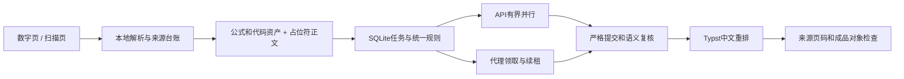

# 分阶段工作流程

一份书籍结构 `book.json`、一份任务数据库 `tasks.db`、一组不可变源资产构成同一任务。请勿在一个任务目录里换书或换页码集合。接口细节见 [ARCHITECTURE.md](../ARCHITECTURE.md)。



## API 与代理

API和代理共用任务、术语规则、结果校验和版本。代理命令：

```powershell
python tp_worker.py --book "试译" --owner worker-1 claim
python tp_worker.py --book "试译" --owner worker-1 renew TASK_ID
python tp_worker.py --book "试译" --owner worker-1 save TASK_ID reply.json
python tp_worker.py --book "试译" status
python tp_worker.py --book "试译" redo ELEMENT_ID
python tp_worker.py --book "试译" terms
```

提交格式：

```json
{"task_id":"领取的任务ID","source_hash":"任务源哈希","translations":{"元素ID":"保留所有 ⟦F:asset_id⟧ 的译文"},"proposed_terms":{}}
```

只翻译任务正文，不翻上下文；不得删除、复制或改写公式标记。租约默认10分钟，长任务建议5分钟续租。失效版本、重复元素、未知元素及标记异常会被拒绝或保存为待修候选。部分有效结果可保留，任务不计为完成。新术语作为提议提交，经协调统一更新JSON，而不是每个代理修改规则。

Ctrl+C停止派发新请求，已保存结果可续传。中断后有效租约到期再释放。`--retry-failed` 重试终止任务，`--task-id`限定指定任务。重做单段保留旧译文历史。翻译、抽样语义复核与视觉检查分别计数。

对于已逐项核验的数量单位、书目日期、月份和跨原页正文，可选择实验性的[显式数字规则与联合复核](EXPLICIT_REVIEW.md)。它们不自动推断全书角色，也不绕过源问题；普通任务保持原协议。

## 原书设计与页码

默认正文10.5pt、习题9.5pt、图注脚注8.5pt。公式是包含实际尺寸及基线的原始对象，不转成近似字符；放不下时调整行和分页。图与图注、关联解释、题目及小问参与内容关联。复杂表格、装饰和跨栏结构仍需样章修正。

已核验的完整多行公式，可在对应元素的 `metadata.display_asset_ids` 中明确列出公式资产ID。公式会独立成块，短括注跟随相邻公式，带题号的习题对齐首行正文。此字段只触发重排，不使相同原生源版本重新翻译。必须先核公式整体范围；不自动选择，超宽仍报错，直接以公式开头且没有引导语的习题暂不支持这个显式模式。

页边标记 `原书 p.82`、`原书 pp.82–83`；无可靠印刷页码时用 `原 PDF 第105页`。来源按页记录，不假定全书固定偏移。允许增页，连续译页可以来自同一原页；不自动附原书或制作并排对照版。

## 输出与判定

| 文件 | 用途 |
|---|---|
| `*_中文阅读版.pdf` | 中文阅读成品或明确标记的预览 |
| `book.json`、`assets/`、`coverage/` | 来源结构、保护对象、字形或OCR单元去向 |
| `tasks.db` | 翻译、租约、版本、复核与用量历史 |
| `layout_map.json` | 元素、源资产在新PDF中的页与坐标 |
| `quality_report.json`、`质量报告.html` | 当前检查、已处理项及待处理项 |
| `visual-qa/` | 成品保护对象像素核对 |
| `last_run_metrics.json`、`runs/` | 各阶段耗时、内存及配置价格下的费用估算 |

排版/QA有阻断问题时退出码为2。生成成功、占位符通过、像素通过都不能单独证明内容和视觉质量。全书自动检查后仍须目视风险页、各章代表页和连续章节。

## 旧版兼容

`--import-legacy`以只读方式核查旧缓存，依原文、位置、页码、提示/规则版本和公式身份迁移；歧义进入待修清单，不用任务编号猜测匹配。旧引擎与旧worker保留在 `legacy_*.py`，新版入口通过 `--legacy`、历史标志或旧manifest分派。旧路径只用于兼容，**不具备全部新版保护与验收保证**。
